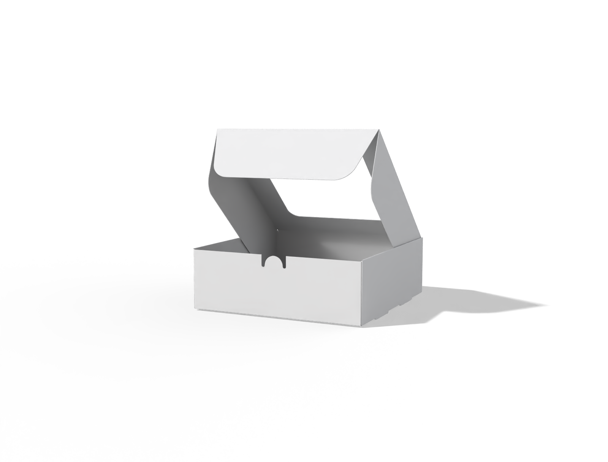
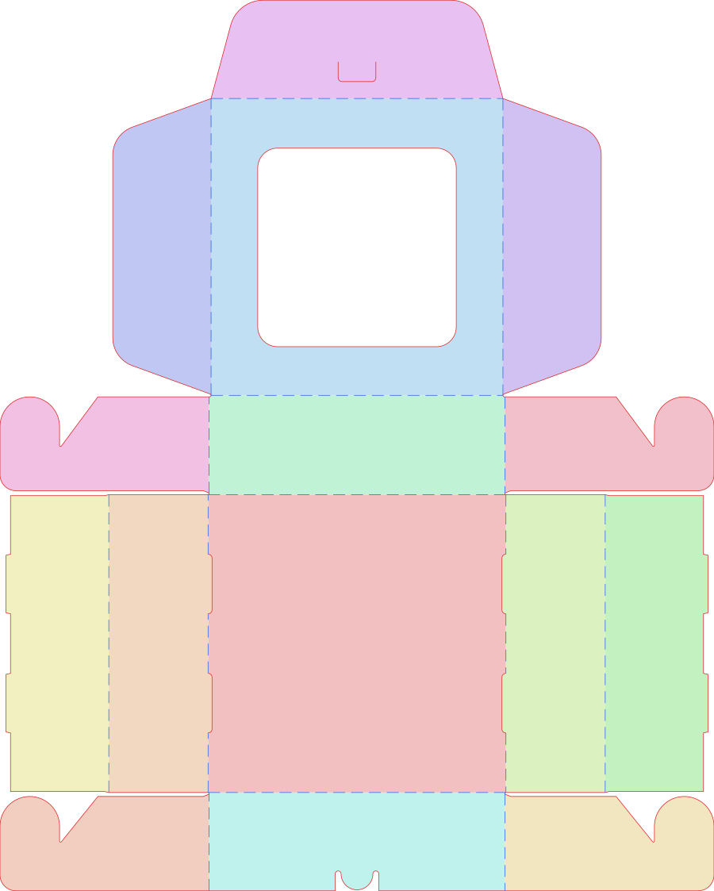

[Español](README.md) · English

# 15030101 — Cake box with window

Acquisition updated October 17, 2026. Source: [Pacdora](https://www.pacdora.com/es/dielines-detail/cake-box-dieline-15030101), internal model 11492, family `MutualLockingCardboardAircraftBoxWithWindow`.



## Result and scope

The box is integrated into `editor-troqueles/dist/`, the target of the root `dist` link. It includes the original local icon and a selection of **12 materials and 18 material/thickness combinations** with captured geometry for **150 × 150 × 50 mm**. The application keeps these dimensions fixed. Actual selection and downloading of all 18 combinations were checked in Chrome, and the SVGs were retained in `exportaciones/`.

The CLI generator also supports eight exact dimensional configurations of the original material, all listed in `configuraciones.json`. There are **26 exact configurations** in total. Dimensions and thicknesses are not interpolated: the affine dimension fit failed independent comparison and remains disabled.

## Base specification

| Property | Value |
|---|---|
| Manufacturing L × W × H | 150 × 150 × 50 mm |
| Internal | 146.4 × 148.9 × 49.4 mm |
| External | 150.4 × 150.4 × 50.4 mm |
| Original material | 350 g white paperboard, ID 103 |
| Original thickness | 0.5 mm |
| Base unfolded blank | 359.6 × 448.5 mm |
| Base geometry | 15 faces, 18 folds, 129 cut commands, 1 interior window |

The limits response for these dimensions declares thickness 0.2–0.5 mm. The three custom materials were captured at 0.2 / 0.35 / 0.5 mm. The editing step was not established. The family declares dimensional limits of 20–2000 mm per axis: these are source metadata, not an enabled range of the local generator. A maximum physical sheet size was not established.

At these dimensions, Pacdora disables 400 g white paperboard (0.55 mm), 120 g kraft (0.14 mm), and all corrugated alternatives. The full matrix is in [MATERIALES.md](MATERIALES.en.md). Observed incompatibility is not generalized to other dimensions.

## Files and reproduction

- `base/`: original geometry, identity, general catalog, limits, and manifest with hashes.
- `troquel-generado.svg`, `troquel-generado.json`, `vista-previa.png`: reproduction and inspection of the base. The inspection SVG retains faces, cuts, arcs, folds, and window; it excludes bleed and dimension annotations.
- `icono.png`: original thumbnail identified by the model's `image` field; `referencia-pacdora.png`: reference blank identified by `knife`.
- `parametricas/`, `independiente/`: dimensional samples; `materiales/`, `personalizados/`: material/thickness samples. Their manifests link hashes, effective configuration, and REA evidence.
- `configuraciones.json`: registry of 26 exact configurations and their provenance.
- `validacion.json`: base structural checks; `validacion-parametrizacion.json`: rejected dimension fit; `verificacion-interfaz.json`: verification of 18 actual downloads.
- `exportaciones/`: SVGs downloaded from the editor. They include active layers and local 3 mm bleed, different from the 5 mm bleed requested when capturing Pacdora.
- `editor-materiales.png`: interface screenshot with 0.35 mm custom kraft.

From the project root:

```sh
python3 geometria/modelos/15030101/preparar-configuraciones.py
python3 geometria/modelos/15030101/generar.py
python3 editor-troqueles/incorporar-modelos-adquiridos.py
```

Generate an exact combination in another directory:

```sh
python3 geometria/modelos/15030101/generar.py --material-id 7 --thickness 0.35 --output-dir /tmp/caja-kraft
python3 geometria/modelos/15030101/generar.py --length 155 --width 155 --height 55 --output-dir /tmp/caja-155
```

The generator rejects combinations without an exact capture. Without `--output-dir`, it replaces the output SVG, JSON, and validation in this directory. Integration always uses the base and adds only profiles at 150 × 150 × 50 mm; preparation processes reapply integration. The active application is `editor-troqueles/`.



## Dimensions, allowances, and parameters

Each axis was investigated separately, and an affine fit was checked against independent combinations. There were 1,389 numeric fields compared per sample, at a tolerance of 0.000001. The maximum error was 7 units across numeric fields, which include coordinates and metadata; this is not interpreted as a physical manufacturing tolerance. The record lists the differences. An approximate dimension engine is not enabled. The parametric reconstruction was attempted and withdrawn: comparisons against retained captures failed with differences of up to 30 mm. The decision and comparison samples are in `correccion/manifest.json`; the large REA bundle is kept locally and excluded from Git.

The additional capture confirmed 155 × 155 × 55 mm with a complete geometric response, internal dimensions 151.4 × 153.9 × 54.4 mm, and external dimensions 155.4 × 155.4 × 55.4 mm. This resolves the request left pending in the first test.

Each enabled profile retains its own internal/external allowances and geometry. Effective thickness is taken from the layer; the `science` object's thickness may be the custom material's default. Material identity and configured thickness in the response are verified. Compatibility is not assumed from equal thickness alone.

For this model, the response has `openParamsStatus=0` and `openParams=[]`. The observed “More” (“Más”) section offers design services, not advanced geometric controls. No observed editable advanced parameters were reproduced.

## Verification and evidence

Hashes, valid JSON/XML, finite numbers, positive extent, and exact preservation of enabled geometries against original responses were checked. The local dieline was visually compared with the original image: outer contour, rounded window, tabs, and fold layout agree; inspection colors differ. This inspection does not replace metric comparison or a physical test.

All **62 editor tests** passed. These include comparison of each new profile with its original response and hash, internal/external conversions, and rejection of uncaptured dimensions/thicknesses. In Chrome, all **18 combinations** were selected and their SVGs downloaded without page errors. The downloaded files' XML was checked. The reproducible script is `scripts/verificar-15030101.cjs`, with the editor served at `http://127.0.0.1:8765/`.

REA references:

| Investigation | Evidence |
|---|---|
| Catalog identity | `ev_08498ad750037811b9ce3f1df9364c88edd6730613017a0a57281de3acfd6ebc` |
| Base geometry | `ev_89ba7b7dfd2c598f54c4d2f5658241fffcecfaef8870723ea2044b409341aae2` |
| Initial dimension variations | `ev_44cda8270657702f72a0085860e251ed8c058492bca976ff675ebcd529971e56` |
| Disabled corrugated-material inventory | `ev_bec757e1032bd313dd177d2022a6e5e17742e1fd8239e847b018ea018941132c` |
| White/kraft/coated-paper inventory | `ev_8bb887655d02174e192d06e5b416612d3dda8a910a7eac54eb4475e71487b280` |
| Material selections | `ev_836fc89dab2fefb6bd594a26b532e8c1a834ac033c170197c1eff5f667909204` |
| Custom thicknesses | `ev_bc1ed27f966ebe5de8d6601bf2c865152ab7f39a67839296d8bc5c45a0b09885` |
| Independent dimension combination and More section | `ev_a24378d16af31f4c9b109d696bcb112bb5a641337fb51fa46095009d65508bd1` |

Initial variation, material-selection, and custom-thickness captures reported `cleanup_incomplete`. Their actions completed and complete geometric responses with hashes were retained; they do not establish successful session closure. The final independent capture ended with `terminated-owned-process`. Exported bundles in `evidencias/modelos/15030101/` preserve original limitations and avoid repeated captures caused by MCP transport errors. No HTTP error responses were observed during the two new material captures.

Continuous dimension editing, unsampled thicknesses, other dimensions for alternative materials, physical assembly, and manufacturing tolerances remain outside the validated scope. Nothing was published or deployed.
