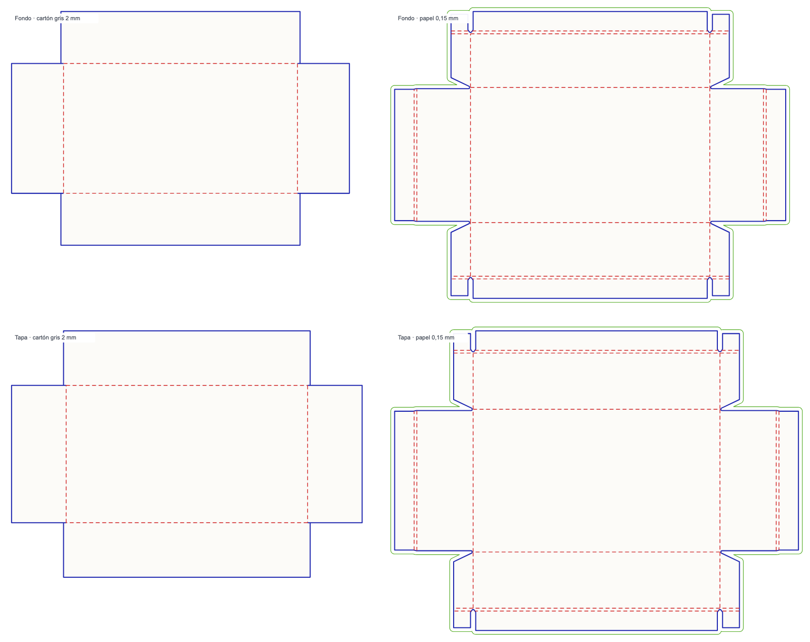

[English](README.en.md) · Español

# Troquel 366010 · Caja rígida con tapa

Fuente: <https://www.pacdora.com/es/dielines-detail/custom-dimensions-box-with-lid-luxury-box-dieline-366010>

Modelo **366010**, «Custom dimensions box with lid luxury box dieline» / «Caja rígida con tapa». La ficha de Pacdora devuelve el id interno **1563**, la categoría `1593` («in the endHalfKnifeUp and Bottom Cover») y la configuración inicial **180 × 100 × 40 mm** de manufactura.



## Identidad y configuración

| Dato | Valor |
| --- | --- |
| Código | 366010 |
| Id Pacdora | 1563 |
| URL | `custom-dimensions-box-with-lid-luxury-box-dieline-366010` |
| Nombre | Caja rígida con tapa |
| Familia | Caja de dos piezas con tapa y fondo |
| Medidas de manufactura | 180 × 100 × 40 mm |
| Medidas interiores | 180 × 100 × 40 mm (según `size` de la respuesta) |
| Medidas exteriores | 189,95 × 109,95 × 44,45 mm |
| Papel | «Personalización premium» (`science_id` 48), 0,15 mm |
| Cartón gris | 2 mm por capa (fondo y tapa) |
| Sangrado | 3 mm |
| Unidad | mm |

La respuesta distingue `knifeSize` (manufactura), `size` (interior) y `outSize` (exterior). Para esta estructura, `size` coincide con `knifeSize`; la diferencia exterior es de 9,95 mm en L y W, y 4,45 mm en H. No se generaliza a otras medidas ni materiales.

## Las cuatro piezas

La geometría no es un único pliego: son dos cajas (fondo y tapa) y cada una tiene cartón gris y papel de envoltura. Se conservan las cuatro capas.

| Pieza | Capa de Pacdora | Espesor | Extensión | Caras | Cortes | Pliegues | Sangrados |
| --- | --- | ---: | ---: | ---: | ---: | ---: | ---: |
| Fondo · cartón gris | `BoutiqueboxDivideEquallyCoverBottomGreyboard` | 2 mm | 260 × 180 mm | 5 | 22 | 4 | 0 |
| Fondo · papel | `BoutiqueboxDivideEquallyCoverBottomFacepaper` | 0,15 mm | 300,95 × 220,95 mm | 25 | 86 | 24 | 38* |
| Tapa · cartón gris | `BoutiqueboxDivideEquallyCoverTopGreyboard` | 2 mm | 269,8 × 189,8 mm | 5 | 22 | 4 | 0 |
| Tapa · papel | `BoutiqueboxDivideEquallyCoverTopFacepaper` | 0,15 mm | 310,75 × 230,75 mm | 25 | 86 | 24 | 38* |

\* Comandos de la capa `bleeds` original; el contorno dibujado se recalcula a 3 mm del corte.

La lámina local compone las cuatro piezas en una cuadrícula de 2 × 2 con 25 mm de separación: **605,55 × 476,7 mm**, **60 caras**, **56 pliegues**, **216 comandos de corte** y **0 orificios interiores**. El orden y la disposición siguen la vista oficial de Pacdora (fondo a la izquierda, papel a la derecha; tapa en la fila inferior).

La respuesta original trae **76 comandos de sangrado**, pero forman un polígono escalonado que no sigue el corte con un offset uniforme: en algunos tramos se separa 6 mm y en las esquinas salta en ángulo recto. Por eso no se usa para dibujar. El SVG y el editor muestran un contorno calculado a **3 mm del corte**, solo para las dos piezas de papel (2 subperfiles); el cartón gris no lleva sangrado. La capa original se conserva como evidencia en `base/knife-00.json` y el contorno calculado en `base/bleed-path.txt`.

## Materiales y espesores

- El papel de envoltura es el material `science_id` 48, «Personalización premium»: 0,15 mm, rango declarado 0,1–0,2 mm, sangrado 3 mm.
- El cartón gris se capturó a **1,5; 1,75; 2; 2,25 y 2,5 mm**. El control de Pacdora llega a 0,5–4 mm, pero solo se habilita el intervalo con geometría verificada.
- En el catálogo local se usa un material compuesto, `Cartón gris + papel 0,15 mm` (id 366010), con espesor editable de 1,5 a 2,5 mm en pasos de 0,25 mm y solo dimensiones de manufactura.
- No se habilitan otros materiales ni el papel de 0,15 mm se varía.

## Motor paramétrico L/W/H/espesor

El modelo es editable entre **L 160–220 mm, W 80–140 mm, H 30–70 mm y espesor 1,5–2,5 mm** (pasos de 0,25). Se capturaron **60 configuraciones L/W/H** y **17 de espesor**; **75** se usan para ajustar y validar.

La geometría del servidor tiene dos regímenes:

- **A (L < 200)**: la profundidad exterior es fija, 15 mm.
- **B (L ≥ 200)**: la profundidad exterior es `clamp(floor(H/2), 15, 20)`. Por eso el plano cambia de tamaño al cruzar **L=200** o al pasar por H=32, 34, …, 40. Es un salto real de Pacdora, no un error de redondeo.

Dentro de cada régimen la geometría de las cuatro capas es afín:

- A: `f = f(180,100,40) + sL·ΔL + sW·ΔW + sH·ΔH`.
- B: `f = f(200,100,40) + sL·ΔL + sW·ΔW + sH·ΔH + sO·(outer−20)`.

Los coeficientes L/W/H se ajustan con muestras de un solo eje (`L195`, `W120`, `H60`, `L210`, `L200/W120`, `L200/H60`, `L200/H30`). Para el espesor se guardan **plantillas base independientes** en L=180 y L=200 para cada uno de los cinco valores: el cartón y el papel compensan distinto, y una recta única no reproducía las esquinas. Las pendientes L/W/H se aplican sobre la plantilla del espesor elegido.

Se valida contra **75 muestras** (58 L/W/H + 17 de espesor), incluidas las esquinas 160/80/30 y 220/140/70. **Error máximo: 0,01 mm**, por debajo de la tolerancia de 0,5 mm. La topología es constante: 5/22/4/0 y 25/86/24/38 en cada configuración.

El motor local `rigid366010` elige la plantilla del espesor, aplica L/W/H, compone las cuatro capas y recalcula el sangrado de 3 mm solo para las dos piezas de papel. El cartón gris no lleva sangrado. El SVG y la vista previa del editor se generan sin consultar Pacdora.

## Archivos

- `troquel-generado.svg`: lámina compuesta a escala real, con corte, pliegue, sangrado y etiquetas por pieza.
- `troquel-generado.json`: geometría de las cuatro piezas y de la lámina compuesta, conteos y procedencia.
- `base/knife-00.json`: respuesta original `project/knife` conservada sin editar.
- `base/details.json`: respuesta original de `models/details`.
- `base/geometria.json`: capas normalizadas y lámina compuesta.
- `base/bleed-path.txt`: contorno de sangrado calculado a 3 mm del corte para las dos piezas de papel.
- `base/manifest.json`: procedencia, configuración, hashes y evidencias.
- `muestras/`: respuestas de las cuatro variantes iniciales.
- `parametricas/`: 60 capturas de la matriz L/W/H y su `manifest.json`.
- `espesor/`: 17 capturas de la matriz de espesor 1,5–2,5 mm y su `manifest.json`.
- `reglas.json`: plantillas de los dos regímenes para cada espesor y coeficientes por campo.
- `parametrizar.py`: ajusta las reglas y valida las 75 muestras del rango.
- `generar.py`: reproduce la base, el SVG, el JSON y el manifiesto sin red.
- `generar-parametrico.py`: genera un SVG/JSON para cualquier L/W/H/espesor del rango, sin red.
- `bleed-node.cjs`: calcula el sangrado de 3 mm con ClipperLib (Node).
- `validar.py`: comprueba la base, el SVG y el sangrado. 
- `validacion-parametrica.json`: error por muestra, regímenes y hashes.
- `integrar.py`: alta en el catálogo, motor, capacidad de material y miniatura.
- `icono-3d.jpg`: mockup oficial de Pacdora, 1920 × 1920.
- `dieline-oficial.png`: vista oficial de Pacdora, usada solo como referencia visual.
- `vista-previa.png`: rasterización local del SVG generado.
- `exportado-editor.svg`: SVG descargado desde la aplicación local a 180 × 100 × 40 mm.
- `exportado-editor-210x120x50.svg`: SVG descargado desde la aplicación a 210 × 120 × 50 mm y 2 mm.
- `exportado-editor-210x120x50-T2.5.svg`: SVG de la misma caja a 2,5 mm.
- `captura-espesor.png`: editor con el selector de espesor en 2,5 mm.
- `captura-editor.png`: captura de la aplicación local con el modelo seleccionado.
- `validacion.json`: comprobaciones, hashes y límites.

## Reproducción

Desde `/Users/fran/Herd/pacdora`:

```sh
python3 geometria/modelos/366010/parametrizar.py
python3 geometria/modelos/366010/generar.py
python3 geometria/modelos/366010/validar.py
python3 geometria/modelos/366010/integrar.py
python3 geometria/modelos/366010/generar-parametrico.py --L 210 --W 120 --H 50 --T 2.5
```

`integrar.py` copia el SVG y las miniaturas a `editor-troqueles/dist/assets/`, actualiza `modelos.json`, `capacidades-materiales.json`, `materiales.json`, la categoría `Rígidas` y las traducciones. No publica ni sube cambios.

## Validaciones realizadas

- `validar.py`: **17 comprobaciones OK** de la base. Incluye XML válido, extensión positiva, conteos por pieza, traslación exacta, nombres únicos, ausencia de NaN/Infinity, no solapamiento y sangrado de 3 mm solo para el papel. La respuesta base coincide capa por capa con una captura CDP independiente.
- `parametrizar.py`: **75 muestras** (58 L/W/H + 17 espesor), **error máximo 0,010 mm**, topología constante y validación de ambas ramas A/B.
- Comparación visual de `vista-previa.png` con `dieline-oficial.png`: coinciden las cuatro siluetas, los pliegues y los sangrados del papel.
- Alta en el catálogo: **366010 · Caja rígida con tapa**, categoría **Rígidas**, motor `rigid366010`, 15 modelos editables.
- Prueba en Chromium 155: selección, edición a **210 × 120 × 50 mm**, 60 caras, 56 pliegues, sangrado de 2 subperfiles y rechazo de L=230. El selector de espesor ofrece **1,5; 1,75; 2; 2,25 y 2,5 mm**, y cambia la geometría (605,55 → 599,15 / 611,95 mm de ancho de lámina). Capturas en `captura-editor.png` y `captura-espesor.png`.
- Descarga real desde la interfaz a 180 × 100 × 40 mm: `troquel-366010-180x100x40mm.svg`, 13.362 bytes, XML válido, 4 etiquetas, corte y sangrado de 2 subperfiles. Se conserva como `exportado-editor.svg`.
- Descarga real a **210 × 120 × 50 mm**: `troquel-366010-210x120x50mm.svg`, 13.468 bytes, XML válido, 4 etiquetas y sangrado de 2 subperfiles. Se conserva como `exportado-editor-210x120x50.svg`.
- Export a **210 × 120 × 50 mm y 2,5 mm**: 13.893 bytes, 4 etiquetas y sangrado de 2 subperfiles. Se conserva como `exportado-editor-210x120x50-T2.5.svg`.
- `generar-parametrico.py --L 210 --W 120 --H 50 --T 2.5`: SVG/JSON offline de **721,95 × 583,51 mm**, con sangrado de 2 subperfiles calculado por Clipper.
- Pruebas del proyecto: **83 pruebas OK**, incluidas `acquired-366010.test.cjs`, `parametric-366010.test.cjs` y `thickness-366010.test.cjs`.

## Límites

- Rango verificado: **L 160–220 mm, W 80–140 mm, H 30–70 mm**. Fuera de él el editor rechaza la medida; no se extrapola.
- El material es fijo (cartón gris + papel de 0,15 mm) y el espesor del cartón se limita a **1,5–2,5 mm en pasos de 0,25 mm**. No se habilitaron otros materiales ni espesores de papel.
- En **L=200** y en los escalones de H (32, 34, …, 40) la profundidad exterior cambia de forma discreta. Es el comportamiento observado del servidor; no es una superficie continua.
- El generador offline usa Node y `ClipperLib` para el sangrado; sin Node, el editor sigue funcionando y calcula el sangrado en el navegador.
- **Estado digital: verificado.** 58 muestras dentro del rango, error 0,000 mm fuera de `/bleeds`; el sangrado dibujado se recalcula a 3 mm y no se compara con las rutas originales.
- No se validó el armado físico, la tolerancia de fabricación, el plegado real ni la resistencia del cartón.
- No se descargaron los archivos AI, PDF o DXF originales: la descarga de Pacdora exige autenticación. El SVG local es una reconstrucción vectorial de la geometría recibida, no el archivo del fabricante.
- La vista previa es una rasterización local; el icono es el mockup oficial. Ninguna de las dos acredita el armado.
- La equivalencia digital no demuestra que la caja sea apta para producción.

## Evidencia

- Página, configuración inicial y respuesta de geometría: `ev_9bbab1a9d4276e5f6454243d88be37c523f6071b25883dbfdd7913a043478f1a` (REA `capture_browser_scenario`, 20/10/2026).
- Segunda ancla REA de la página y la geometría base: `ev_8a1f522b2feaaf33ae7d8b02bf6d78896d54af4583da1044013d07d7fba9017e`.
- Captura REA de la página con L=200: `ev_700ae83528d04468565ebaa8c797a41ee7ba549744bc572db355405341c67f77`; el presupuesto de eventos no retuvo el cuerpo de esa variante, que sí está en la matriz CDP.
- Matriz de **60 capturas L/W/H** en `parametricas/manifest.json` y **17 de espesor** en `espesor/manifest.json`; el detalle de error por muestra está en `validacion-parametrica.json`.
- Anclas REA y muestras CDP se conservan completas; no se repitieron capturas ya completadas.
